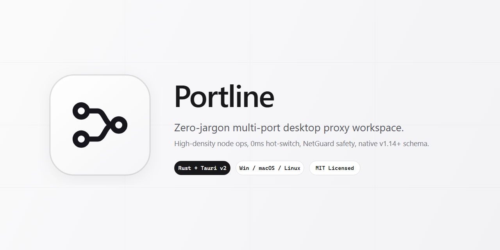

<p align="center">
  
</p>

<p align="center">
  <strong>English</strong> | <a href="README.zh-CN.md">简体中文</a> | <a href="DESIGN.md">Design System</a>
</p>

<p align="center">
  
  
  
  
  
</p>

# Portline

**Portline** is a calm, high-density cross-platform desktop proxy workspace built with **Rust, Tauri v2, and React**, targeting the strict **`sing-box v1.14+`** native schema.

It combines V2rayN-grade scattered node management efficiency, zero-jargon plain-language split routing, multi-port local inbounds, transactional OS proxy/DNS recovery (**NetGuard**), and modern live observability in a lightweight single-file native executable.

## Key Features

- **High-Density Virtualized Node Pool**: Import share URIs (`VLESS Reality/WS/gRPC/HTTPUpgrade`, `VMess`, `Trojan`, `Shadowsocks`, `Hysteria2`, `TUIC`, `AnyTLS`, `WireGuard`, `HTTP(S)`, `SOCKS5`), Base64 subscriptions, `sing-box` JSON, or Clash YAML. Crisp vector SVG country flags (`country-flag-icons`), compact `+n` hoverable rule badges, and **0ms zero-downtime hot-switching** via the local Control API.
- **Classic Community Routing, Route Tester & Multi-Port Inbounds**: One-click classic community strategies (`Bypass Mainland China`, `GFW Proxy List`, `Bypass CN + Platform Split`) backed by 32 official SagerNet `geosite-*` / `geoip-*` binary `.srs` rule-sets, a built-in domain/URL/IP/process Route & DNS target tester, dynamic fastest-by-region groups (`auto:US`, `auto:JP`, `auto:ALL`, ...), and optional dedicated local inbound ports (e.g., `:10809` pinned to a specific exit for CLI/Docker).
- **Dedicated DNS Tab & Visual `sing-box v1.14+` Config**: Configure domestic/remote DNS (UDP/TCP/DoH/DoT/DoQ/H3), remote DNS detour, Bootstrap DNS, FakeIP CIDR pools, static Hosts, custom DNS rules, log level, protocol sniffing, process detection, TUN stack/MTU, URLTest, and cache file visually -- compiled with Reachability Tree-Shaking and zero deprecation warnings.
- **Preflight Rollback Guarantee**: Every config change is validated with `sing-box check -c` before swapping. Invalid configurations are blocked cleanly without disconnecting active traffic.
- **Unified RTT Latency Engine & Telemetry HUD**: Concurrent TCPing plus isolated no-TUN real-delay probing over an ephemeral loopback SOCKS5 inbound that strips first-connection DNS/TCP/TLS handshake overhead (Unified RTT, on by default, toggleable in Settings), streamed live to a precision telemetry progress HUD with zero interruption to active connections.
- **Live Observability, Connection History & Platform Analytics**: Live 60s throughput canvas, paginated active connections and 500-line ring-buffer logs, SQLite connection history persistence, and per-platform cumulative traffic statistics (`Today` / `7 Days` / `30 Days` / `All Time`).
- **Custom System Tray Popover, Launch at Login & NetGuard Safety**: Frameless taskbar popover for 1-click mode/proxy/TUN/core controls, optional silent Launch at Login (off by default, no admin rights required), transactional OS proxy/DNS snapshots with crash recovery (**NetGuard**), and single-folder **Portable Mode** (`portable.json`).

## Downloads

Pre-built Windows releases are published automatically on [GitHub Releases](https://github.com/Nexusyyan/portline/releases):

- **Portable With-Core Bundle (`portline-vX.Y.Z-x86_64-windows-portable.zip`)**: Extract and connect immediately without needing prior GitHub access; bundles `portline.exe`, official unmodified `core/sing-box.exe` (SHA-256 verified), `portable.json`, `LICENSE`, and `THIRD_PARTY_NOTICES.md`. All data stays in `./portline-data/`.
- **Standalone Lightweight Executable (`portline-vX.Y.Z-x86_64-windows.exe`)**: Single-file GUI without core bundled; place `sing-box.exe` in `./core/` or import locally inside the app.
- **Integrity Check**: Verify downloaded files against `SHA256SUMS.txt` attached to every release.

## Architecture

```text
portline/
├── crates/
│   ├── portline-core/       # NodeIR, URI/Base64/JSON/YAML parsers, v1.14+ compiler, Control API, NetGuard, SQLite, tester, supervisor
│   ├── portline-ipc/        # Typed JSON-RPC IPC contract + session token + SDDL ACL
│   └── portline-service/    # Privileged service daemon with GUI heartbeat watchdog & NetGuard rollback
├── src-tauri/               # Non-elevated Tauri v2 desktop host, native tray, single-instance guard
├── src/                     # React 19 + TypeScript + Tailwind v4 bilingual UI (en / zh-CN)
└── DESIGN.md                # Canonical Antigravity Minimalist Neutral design system
```

## Development & Build

### Prerequisites

- Rust stable (`rustc` + `cargo` + `clippy`)
- Node.js 22+ and `pnpm` 11+
- WebView2 Runtime (pre-installed on Windows 10/11)

### Commands

```powershell
pnpm install --frozen-lockfile
pnpm typecheck
pnpm test
pnpm build
cargo clippy --workspace --all-targets -- -D warnings
cargo test --workspace

# Standalone single-file Release executable
pnpm tauri build --no-bundle
```

## Compliance & License

- **License**: Portline is licensed under the [MIT License](LICENSE).
- **Clean Out-of-Process Isolation**: Portline does **not** statically or dynamically link `libbox` or fork any proxy core source code. It downloads and invokes official, unmodified `sing-box v1.14+` executables strictly out-of-process with SHA-256 verification. See [THIRD_PARTY_NOTICES.md](THIRD_PARTY_NOTICES.md).
