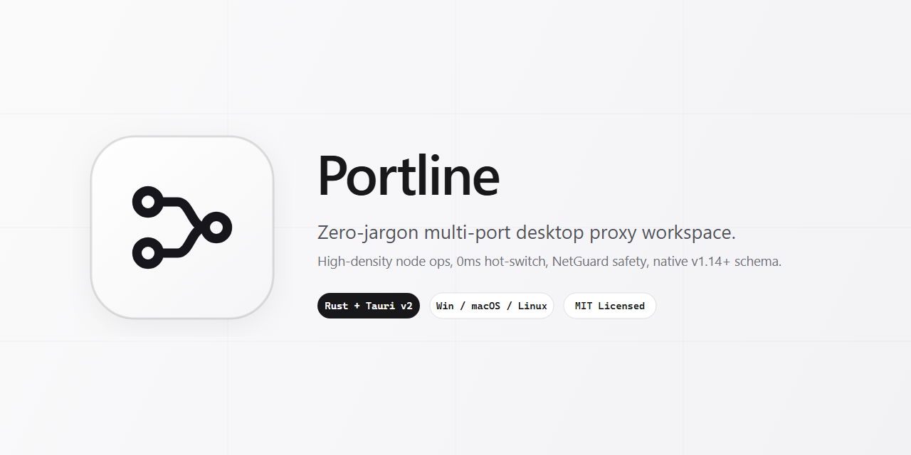

<p align="center">
  
</p>

<p align="center">
  <a href="README.md">English</a> | <strong>简体中文</strong> | <a href="DESIGN.md">设计规范 (DESIGN.md)</a>
</p>

<p align="center">
  
  
  
  
  
</p>

# Portline

**Portline** 是一款基于 **Rust + Tauri v2 + React** 打造的现代开源跨平台桌面代理客户端，面向纯净的 **`sing-box v1.14+`** 原生 Schema。

核心体验定位：**V2rayN 级高密度节点池运维效率 × 零术语人话分流与多端口入口 × 事务化防断网保护（NetGuard） × 轻量原生桌面可观测性**。

## 核心特性

- **高密度虚拟滚动节点池**：支持导入 `VLESS (Reality/WS/gRPC/HTTPUpgrade)`、`VMess`、`Trojan`、`Shadowsocks`、`Hysteria2`、`TUIC`、`AnyTLS`、`WireGuard`、`HTTP(S)`、`SOCKS5` 分享链接、Base64 订阅、`sing-box` JSON 与 Clash YAML；内置矢量 SVG 国旗（修复 Windows 字符国旗缺失）、精简 `+n` 悬浮规则徽标，双击即可经本地控制 API **0ms 零断流热切换主出口**。
- **经典社区 Site/IP 分流策略、去向测试器与多端口入口**：内置 3 套一键切换社区策略（绕过大陆白名单 / GFW 代理列表 / 绕过大陆 + 平台分流）与 32 项官方 SagerNet `geosite-*` / `geoip-*` 二进制 `.srs` 预设库；提供域名/URL/IP/进程实时去向与 DNS 测试器、按地区自动优选最快节点，并可按需增开专属本地端口（如 `:10809`）。
- **独立 DNS 解析页与可视化 `sing-box v1.14+` 配置**：可视化配置国内外上游 DNS（UDP/TCP/DoH/DoT/DoQ/H3）、远端 DNS 出口、Bootstrap、FakeIP 网段、静态 Hosts、自定义 DNS 规则、日志级别、协议嗅探、进程检测、TUN 参数与缓存文件，按需 Tree-Shaking 编译零弃用警告配置。
- **配置预检与零断流回滚**：每次变更均先运行 `sing-box check -c` 校验；非法配置直接阻断并保留旧活跃进程，绝不踢断现有网络连接。
- **Unified RTT 剥离握手测速与精密遥测 HUD**：支持高并发 TCPing 与独立无 TUN 隔离内核真连接测速（通过临时回环 SOCKS5 隧道预热保活连接并剥离 DNS/TCP/TLS 首次握手开销，默认开启，可在设置中切换），实时推送至高精度遥测进度条，Windows Job Object 托管零孤儿进程。
- **可观测性、历史连接与分平台流量统计**：实时 60s 吞吐曲线、分页活跃连接与 500 行环形日志，自动持久化 SQLite 历史连接记录，按「今日 / 7 天 / 30 天 / 全部」统计各平台累计流量消耗。
- **自定义托盘浮层、开机自启动与 NetGuard 防断网保护**：右键托盘弹出精致浮层快速切换模式/代理/TUN/启停内核；支持用户级静默开机自启动（默认关闭，无需管理员权限）；NetGuard 事务快照自动备份与崩溃恢复系统代理；放置 `portable.json` 即可开启便携模式。

## 下载安装

请前往 [GitHub Releases](https://github.com/Nexusyyan/portline/releases) 下载对应版本：

- **便携完整包（`portline-vX.Y.Z-x86_64-windows-portable.zip`，推荐）**：开箱即用，内置 `portline.exe`、经 SHA-256 校验的官方未修改 `core/sing-box.exe`、`portable.json` 与许可文档；即使处于无法访问 GitHub 的网络环境也能解压直连，所有数据保存在 `./portline-data/`。
- **独立轻量单文件（`portline-vX.Y.Z-x86_64-windows.exe`）**：仅包含 GUI 本体，可自行在同目录 `core/` 放入 `sing-box.exe` 或在软件内离线导入。
- **完整性校验**：每个 Release 均附带 `SHA256SUMS.txt` 校验文件。

## 本地开发与构建

```powershell
pnpm install --frozen-lockfile
pnpm typecheck
pnpm test
pnpm build
cargo clippy --workspace --all-targets -- -D warnings
cargo test --workspace

# 编译单文件便携 Release 可执行程序
pnpm tauri build --no-bundle
```

## 开源协议与合规说明

- **协议**：Portline 主仓库采用 [MIT License](LICENSE) 开源。
- **进程外干净隔离**：Portline 绝不静态或动态链接 `libbox`，亦不维护或复用任何内核 Fork 源码；仅以独立子进程方式调用带 SHA-256 校验的官方未修改 `sing-box v1.14+` 二进制文件。详见 [THIRD_PARTY_NOTICES.md](THIRD_PARTY_NOTICES.md)。
